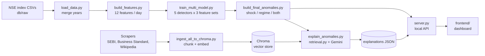

# NIFTY 50 Anomaly Detection with RAG Explanations

Detects unusual trading days on the NIFTY 50 index with an ensemble of
unsupervised models, labels each one as a **shock**, a **regime** anomaly or
**both**, and explains it with retrieval-augmented generation: news, SEBI
circulars and Wikipedia event articles dated near the day are retrieved from a
vector store and passed to Gemini, which must ground its answer in them.
Everything is browsable in a local web dashboard, where any flagged day can be
explained on demand.

<!-- Numbers below come from db/validation/*.md and are regenerated by the validation scripts. -->

**Highlights**

- Five detectors (Isolation Forest, One-Class SVM, Local Outlier Factor, Elliptic Envelope, kNN distance) combined by rank averaging.
- Separate **shock** (single-day) and **regime** (20–60-day) models, so one-day events in calm markets aren't drowned out by long crises.
- The shock ensemble flags all **13/13** reference market events, **11/11** of them in a walk-forward test that never sees the future.
- Anomaly-aware retrieval finds the real cause for **9/13** reference events vs **5/13** for a naive baseline, and never uses off-period background articles.
- Dashboard with interactive chart, filters, model agreement, sources, and a **See explanation** button backed by a local API.

---

## Contents

- [How it works](#how-it-works)
- [What the anomaly types mean](#what-the-anomaly-types-mean)
- [Results](#results)
- [Project structure](#project-structure)
- [Setup](#setup)
- [Running the dashboard](#running-the-dashboard)
- [Rebuilding the pipeline](#rebuilding-the-pipeline)
- [Validation](#validation)
- [Data sources and coverage](#data-sources-and-coverage)
- [Limitations and future work](#limitations-and-future-work)

---

## How it works



1. **Features.** Each trading day is described by 12 numbers: single-day measures (log return, opening gap, intraday range, return z-score vs the last 20 days) and period measures (5/20/60-day returns and volatility, distance from the 60-day average, a rolling Sharpe-like ratio). Every feature uses only past data.
2. **Detection.** Five unsupervised detectors score every day. Scores are turned into percentile ranks and averaged; the top 5% of days are flagged. *Agreement* is how many of the five models individually put the day in their own top 5%.
3. **Two questions, two ensembles.** The **shock** ensemble sees only the 4 single-day features; the **regime** ensemble only the 6 20/60-day features. A day is labelled by which ensemble(s) flagged it. Consecutive regime days are grouped into *episodes*.
4. **Retrieval** (`backend/src/rag/retrieval.py`), per flagged day:
   1. 2–3 queries worded for the anomaly: direction (fall/rise), kind (shock/regime) and date.
   2. News and SEBI searched only near the day (−2…+3 days for a shock, the whole episode ±5 days for a regime).
   3. Score = cosine similarity + bonuses for date proximity (earlier pieces count as further away), mentioning the market, and — on shock days — describing a move in the same direction.
   4. A similarity floor drops off-topic chunks instead of always returning *k*; one chunk per article.
   5. **Wikipedia only if needed:** used only when fewer than 2 relevant news chunks exist, and only for articles about events dated within 45 days.
5. **Explanation.** Gemini receives the anomaly's numbers, the retrieved context and retrieval notes, and must answer in a fixed structure — *Likely cause*, *Supporting evidence*, *Confidence*, *Caveats* — citing only the retrieved material.

## What the anomaly types mean

| Type | Question it answers | Typical example |
|---|---|---|
| **Shock** | Was *this day itself* extreme? (return, gap, intraday swing) | 4 Jun 2024 election results, −5.9% in one day |
| **Regime** | Is the day inside an *unusual period* of trend/volatility? The day itself may look ordinary. | 9 Mar – 13 Jul 2020 COVID episode |
| **Shock + regime** | An extreme day inside an unusual period | 23 Mar 2020, −13.9% during the COVID crash |

Splitting the two matters: with all 12 features in one model, 62% of flags landed in 2020 and isolated one-day events (e.g. Union Budget days) were missed; the shock ensemble catches all 13 reference events.

## Results

Full reports: [`db/validation/NIFTY50_model_validation.md`](db/validation/NIFTY50_model_validation.md) and [`db/validation/NIFTY50_retrieval_eval.md`](db/validation/NIFTY50_retrieval_eval.md).

**Detection** (NIFTY 50, Oct 2016 – Jul 2026, 2,418 trading days)

| Check | Shock ensemble | Regime ensemble |
|---|---|---|
| Reference events on a flagged day (13) | **13 / 13** (p ≈ 7·10⁻¹⁸ vs random) | 4 / 13 (it targets periods, not days) |
| Walk-forward, past data only: events caught | **11 / 11** | 6 / 11 |
| Walk-forward: rank correlation with full-history scores | 0.97 | 0.85 |
| Walk-forward: share of days flagged (target 5%) | 6.9% | 18.4% ⚠️ |
| Flagged days unchanged across random seeds (Jaccard) | 0.97 | 0.99 |
| … when 20% of the data is removed | 0.91 | 0.92 |
| Synthetic anomalies detected | 93% of 3σ jumps, 100% of ≥4σ | 39–72% of volatility bursts, 50–83% of drifts |
| False alarms on untouched control stretches | 0% | 0–11% |
| Volatility over the next 20 days vs other days | 1.7× | 1.9× |

The shock detector holds up across every check. The regime detector separates calm from turbulent periods well, but its threshold depends on what history it has seen: trained only on the calm 2016–2018 years, a past-only version flags 42% of 2019 and 72% of 2020. For live use it would need a rolling training window or recalibrated thresholds; for retrospective analysis (how it is used here) the full-history fit is appropriate.

**Retrieval** (context handed to the explainer; no LLM involved in the measurement)

| | Naive baseline (v1) | Anomaly-aware (v2) |
|---|---|---|
| Reference events where the context mentions the actual cause | 5 / 13 | **9 / 13** |
| Wikipedia chunks about an unrelated period | 56% | **0%** |
| Days using Wikipedia at all | 100% | 53% |
| Repeated-article chunks | 7% | **0%** |
| News distance from a shock day (mean) | 2.1 days | **1.1 days** |
| Days with no relevant context (explainer says so) | 0% | 19% |

## Project structure

```
nse-anomaly-rag/
├── backend/
│   ├── requirements.txt
│   └── src/
│       ├── features/
│       │   ├── load_data.py              # merge yearly NSE CSVs -> <SECTOR>_merged.csv
│       │   └── build_features.py         # 12 daily features -> <SECTOR>_features.csv
│       ├── models/
│       │   ├── train_isolation_forest.py # single-model baseline, all 7 sectors (+ shared config)
│       │   ├── train_multi_model.py      # 6 detectors x {shock, regime, all} feature sets
│       │   ├── build_final_anomalies.py  # shock/regime/both labels + regime episodes
│       │   └── validate_models.py        # validation suite (walk-forward, injection, ...)
│       ├── rag/
│       │   ├── scrapers/                 # SEBI, Business Standard, Wikipedia (+ Moneycontrol, unused)
│       │   ├── ingestion/
│       │   │   └── ingest_all_to_chroma.py
│       │   ├── retrieval.py              # anomaly-aware retrieval pipeline
│       │   ├── explain_anomalies.py      # RAG + Gemini explainer (batch or --date)
│       │   └── evaluate_retrieval.py     # v1 vs v2 retrieval comparison
│       ├── export_frontend_data.py       # static JSON bundle for the dashboard
│       └── server.py                     # local dashboard server + explain API
├── frontend/                             # dashboard (HTML/CSS/JS, ECharts)
│   └── data/NIFTY50.json                 # static fallback bundle
└── db/
    ├── raw/<SECTOR>/                     # NSE index OHLC CSVs, one per year
    ├── raw_text/{sebi,news_bs,wikipedia} # scraped documents (JSON)
    ├── processed/                        # merged prices, features, model outputs
    ├── models/                           # fitted models (joblib); multi/ = ensemble members
    ├── events/NIFTY50_known_events.csv   # reference events used in evaluation
    ├── rebalancing/                      # index rebalancing dates (context only)
    ├── explanations/                     # generated explanations (JSON)
    ├── validation/                       # validation and retrieval reports
    └── vectorstore/                      # Chroma store (git-ignored, rebuilt locally)
```

## Setup

Requires **Python 3.11+** and a **Gemini API key** (only for generating explanations). Commands below are for Windows PowerShell from the repository root; on macOS/Linux use `source backend/.venv/bin/activate` and `export GEMINI_API_KEY=...`.

```powershell
# 1. Virtual environment and dependencies
python -m venv backend\.venv
Set-ExecutionPolicy -Scope Process -ExecutionPolicy RemoteSigned
.\backend\.venv\Scripts\Activate.ps1
pip install -r backend\requirements.txt

# 2. Build the vector store from the scraped documents in db/raw_text
#    (git-ignored, ~360 MB; downloads the embedding model on first run)
python backend\src\rag\ingestion\ingest_all_to_chroma.py

# 3. Gemini key, in the same terminal that will run the server
$env:GEMINI_API_KEY = "your-key-here"
```

Processed data, model outputs and the final anomaly labels are committed, so after these steps the dashboard works without re-running the pipeline.

## Running the dashboard

```powershell
python backend\src\server.py            # http://127.0.0.1:8000
python backend\src\server.py --port 8080
```

Open the printed address. Select a flagged day on the chart or in the table and press **See explanation**: the server runs the explainer for that day (10–30 s) and saves the result to `db/explanations/`, so it is instant next time. The pill in the header shows whether the explanation service is ready (it reports a missing key or vector store).

The server binds to `127.0.0.1` only, because the explain endpoint spends your Gemini quota.

Without the server, the page can also be opened from any static file host (it falls back to `frontend/data/NIFTY50.json`, built by `export_frontend_data.py`), but then explanations are read-only.

## Rebuilding the pipeline

Run from the repository root with the virtual environment active. Each step reads the previous step's output from `db/`.

| Step | Command | Output |
|---|---|---|
| 1. Merge raw CSVs | `python backend\src\features\load_data.py` | `db/processed/<SECTOR>_merged.csv` |
| 2. Features | `python backend\src\features\build_features.py` | `db/processed/<SECTOR>_features.csv` |
| 3. Baseline model (all sectors) | `python backend\src\models\train_isolation_forest.py` | `db/processed/<SECTOR>_anomalies.csv` |
| 4. Ensembles | `python backend\src\models\train_multi_model.py` | `db/processed/NIFTY50_{shock,regime,all}_model_comparison.csv` |
| 5. Labels | `python backend\src\models\build_final_anomalies.py` | `db/processed/NIFTY50_final_anomalies.csv` |
| 6. Explanations (optional) | `python backend\src\rag\explain_anomalies.py` | `db/explanations/NIFTY50_explanations.json` |
| 7. Static bundle (optional) | `python backend\src\export_frontend_data.py` | `frontend/data/NIFTY50.json` |

Step 6 explains flagged days since `MIN_ANOMALY_DATE` (2023-01-01) in batches of 30, one representative day per regime episode. To explain a single day of any year:

```powershell
python backend\src\rag\explain_anomalies.py --date 2024-06-04
python backend\src\rag\explain_anomalies.py --date 2024-06-04 --force   # regenerate
```

To re-collect documents, run the scrapers in `backend/src/rag/scrapers/` (listing stage first, then the `fetch_*_text.py` stage), then re-run ingestion. `sebi_scraper.py` drives Chrome and additionally needs `pip install selenium webdriver-manager`.

## Validation

```powershell
python backend\src\models\validate_models.py            # ~8 min; --quick for a faster pass
python backend\src\rag\evaluate_retrieval.py            # ~10 min, no API key needed
```

There are no ground-truth labels for "anomalous day", so the model report combines several independent checks:

| Check | What it tests |
|---|---|
| Known events + hypergeometric test | Do reference events land on flagged days more often than random 5% flags would? |
| Contamination sensitivity | How recall changes from 1% to 10% flagged |
| **Walk-forward** | Train only on earlier years, flag the next year with a threshold fixed in advance — no look-ahead |
| Seed / subsample stability | Do the flagged days change with the random seed or with 20% of the data removed? |
| **Synthetic injection** | Plant shocks (2–6σ jumps), volatility bursts and drifts of known size into calm stretches of the real series; measure detection vs untouched controls |
| Separation & forward validity | Are flagged days different on raw measures, and are the following 5/20 days more volatile? |
| Model agreement | Spearman correlation between the detectors' scores |

The retrieval report compares the original retrieval with the anomaly-aware pipeline on all flagged days and checks, for the 13 reference events, whether the retrieved context actually mentions the known cause.

## Data sources and coverage

| Source | Content | Coverage |
|---|---|---|
| NSE / niftyindices.com | Daily OHLC for NIFTY 50 and 6 sector indices | Aug 2016 – Jul 2026 |
| SEBI | Circulars (PDF text) | 2016 – 2026, ~1,200 documents |
| Business Standard | Markets news articles | **2022 – 2026**, ~2,000 articles |
| Wikipedia | Articles on major market events | 14 articles, 2016 – 2023 |
| `db/rebalancing/` | Approximate index rebalancing dates | Annotation only; verify against NSE circulars |

Because news coverage starts in 2022, anomalies before 2022 are explained from Wikipedia event articles where one exists near the date, and otherwise the explainer reports that no relevant context was found.

## Limitations and future work

- **News gap before 2022.** `fetch_mcnews.py` (Moneycontrol, 2016–2021) is written but not yet run or ingested; adding it would close the biggest retrieval gap.
- **Small reference set.** 13 hand-picked events, also used when designing the shock/regime split; the walk-forward and injection tests are the less biased evidence.
- **Full-history fit.** The production models fit all history at once (fine for retrospective analysis). The walk-forward test shows the shock model transfers well to a live, past-only setting, but the regime model over-flags with short history — a rolling window or recalibrated threshold would be needed before using it live.
- **Other sectors** still use the single Isolation Forest baseline (`train_isolation_forest.py`); the ensemble and dashboard are NIFTY 50 only.
- **Explanations are generated, not verified** — read them alongside their sources. Nothing here is investment advice.
